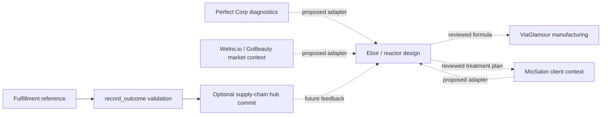

# COG253 applied to SkinTwin

COG253 is the **253-pattern language**, including cog253 (Personal Cognitive
Touches). This application translates all three scales into SkinTwin decisions:
94 ecosystem patterns (cog001–cog094), 110 subsystem patterns (cog095–cog204),
and 49 primitive patterns (cog205–cog253).

[catalog.json](catalog.json) is the byte-for-byte unified dataset from the supplied
`cog253-goals.zip`, member
`.goals/oc-cog253-pattern-language/patterns/cog253-complete.json`. It preserves
names, original GH253 names, interpretations, OpenCog components, related-pattern
links, and category ranges, including the source's text encoding artifacts.
[application.json](application.json) records source checksums and assigns every
pattern to exactly one SkinTwin decision group. Related-pattern links still cross
group boundaries; groups do not replace the source topology. OpenCog component
names in the catalog describe the source architecture, not installed dependencies.

The archive also contains goals for OpenCog builds, CogServer, KoboldCpp, and
operator UIs. Those target another codebase and are not imported as workbench
requirements. No OpenCog runtime is required for this application.

## Current implementation and proposed ecosystem

The runnable workbench is `chain_stage.py`: it validates an outcome and optionally
asks a separately checked-out supply-chain hub to commit it. The Alchemist Engine
and provider integrations are architecture specifications. The Perfect Corp
OpenAPI file describes that provider's API; it is not a SkinTwin server contract.
Existing research claims about medical performance or compliance are not verified
by COG253 or these command tests.



Dotted arrows are design work. The solid arrows show the existing local outcome
path. Without a configured ledger, a successful command only returns an artifact;
it neither verifies a fulfillment nor persists an outcome.

## Decisions at each scale

The complete ID membership, rationale, status, and evidence paths live in
[application.json](application.json). `applied` means changed here (including
documentation), `existing` identifies limited behavior already present, `design`
is guidance for future implementation, and `deferred` has no current runtime
requirement. A group status never claims full OpenCog functionality.

| Scale | Patterns and SkinTwin application | Evidence or next step |
| --- | --- | --- |
| Ecosystem | cog002, cog006, cog013–cog015: separate diagnostics, business context, marketplace, and manufacturing responsibilities | Verify each provider contract before implementing an adapter |
| Ecosystem | cog008, cog016, cog027: combine diagnostic tensors with explicit concern and fulfillment identifiers | Define units, provenance, and schema versions before data fusion |
| Ecosystem | cog017, cog025, cog064: close the fulfillment-to-outcome loop | `record_outcome` links a score to a fulfillment; automated learning remains design work |
| Ecosystem | cog021, cog042, cog049: bound multi-step elixir execution | Use reactor constraints and reviewed, versioned transformations from the engine specification |
| Subsystem | cog102, cog113, cog160, cog198: normalize external provider data behind adapters | Perfect Corp scores must not be assumed equivalent to workbench outcome scores |
| Subsystem | cog129, cog133, cog168: retain shared vocabulary and outcome provenance | Hub history is optional; diagnostic stores and elixir histories are future work |
| Subsystem | cog173, cog183, cog188: isolate client and tenant context | Consent and access enforcement are prerequisites for live integrations |
| Subsystem | cog184, cog200: make optional hub configuration explicit | Document ledger, hub root, and dispatch behavior below |
| Primitive | cog197, cog217, cog238, cog243: validate input before dispatch | Object checks, score normalization, structured CLI errors, and rejection tests |
| Primitive | cog218, cog224, cog225: keep the local command contract small | One command, four artifact fields, success/error response, and exit status |
| Primitive | cog247: preserve explicit behavior without optional infrastructure | Standalone artifact validation succeeds; ledger-backed requests fail when the hub is absent |
| Primitive | cog250, cog253: retain SkinTwin vocabulary and support deliberate personalization | Elixirs, tensors, and reactors remain design terms; preferences cannot bypass validation or evidence requirements |

Attention schedulers, distributed AtomSpaces, autonomous bots, dashboards, and new
provider connections are not implemented. Add them only with a concrete workload,
verified contracts, focused tests, and an updated application decision. Client
images and histories do not belong in this public reference catalog.

## Try the local outcome contract

From the repository root, with no ledger configured:

```bash
printf '%s\n' '{"command":"record_outcome","args":{"outcome_id":"outcome-1","fulfillment_id":"order-treatment","concern":"pigmentation","score":" 81 "}}' | python3 chain_stage.py
```

The response is:

```json
{"ok": true, "artifact": {"outcome_id": "outcome-1", "fulfillment_id": "order-treatment", "concern": "pigmentation", "score": 81}}
```

Requests and `args` must be JSON objects; missing or null `args` is validated as
an empty object. All three identifier/concern fields must be nonempty strings
and are trimmed. Scores must be integers from 0 to 100; decimal digit strings
(including surrounding whitespace) normalize to integers. Booleans, floats,
negative numeric strings, unsupported strings, and numerals exceeding Python's
integer conversion limit are rejected. Extra fields
are not included in the artifact. Missing fields, malformed JSON, invalid shapes,
and invalid scores return `{"ok": false, "error": "..."}` and CLI exit code 1.
Success exits 0. Invalid commands never dispatch to the hub.

| Configuration | Behavior |
| --- | --- |
| `SKINTWIN_CHAIN_LEDGER` unset or empty | Validate and return an artifact; no persistence |
| `SKINTWIN_CHAIN_LEDGER` set | Require a registered hub; commit normalized arguments only after validation |
| `SKINTWIN_HUB_ROOT` set | Prefer that registered hub; otherwise search sibling checkouts |
| `SKINTWIN_CHAIN_SKIP_DISPATCH=1` | Bypass hub dispatch for controlled local validation; success does not mean persistence |

The hub must contain `domain/org-ecosystem.json` (with `hub.name` matching its
directory), `domain/supply-chain.json`, and `domain/locate.py`. The hub owns
fulfillment-existence and duplicate-outcome checks. This command offers no
authentication or tenant isolation and is a local integration entry point.

## Verify and maintain

```bash
python3 -m unittest -v test_cog253 test_chain_stage
```

The catalog checks verify all 253 IDs, the three category ranges, required source
fields, related-pattern references, complete and unique application coverage,
source checksum, and repository evidence paths. Outcome tests exercise malformed
requests, normalization, rejection before dispatch, CLI responses, and optional
hub behavior. The two real-hub integration tests run when a registered sibling
hub or `SKINTWIN_HUB_ROOT` is available; otherwise they are explicitly skipped.

For a new integration or changed command, identify the affected catalog IDs,
update their application decision and evidence, and test its actual behavior.
Move a decision from `design` to `applied` only when that behavior exists and is
verified. Keep the upstream catalog unchanged; record a new source version and
checksums explicitly if replacing it.
